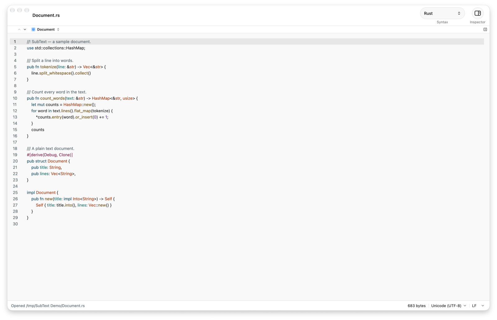
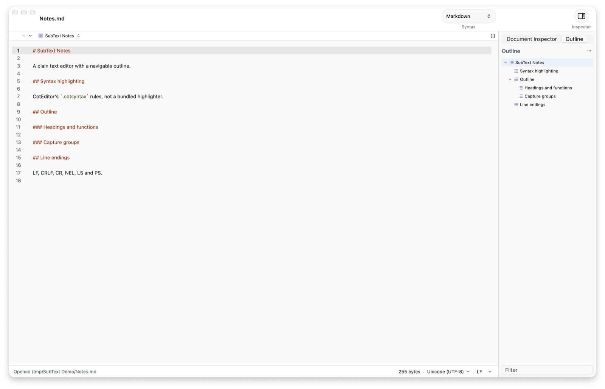

<div align="center">

# SubText

**用 Rust 与 [GPUI Kit](https://github.com/longbridge/gpui-kit) 重写的 [CotEditor](https://github.com/coteditor/CotEditor)。**

菜单、快捷键、语法定义、主题与检查器逐项对齐；不是"类似"，而是同一份规格。

[](https://github.com/jincaiw/subtext/actions/workflows/ci.yml)
[](LICENSE)
[](rust-toolchain.toml)
[](https://github.com/jincaiw/subtext/releases)

面向 macOS、Linux 与 Windows 的纯文本编辑器。**macOS 已实际运行验证**；Linux 与 Windows
有可构建的发布产物，尚未实际运行验证。

</div>



## 简介

CotEditor 是 macOS 上最完整的纯文本编辑器之一，但它与 Cocoa 绑得很深：`NSTextView`、
`NSDocument`、storyboard 里的 `NSMenu`、`@objc` 响应链。SubText 保留用户能看到和能按到的
一切，只替换底下的框架：

| CotEditor | SubText |
| --- | --- |
| AppKit `NSTextView` | `gpui-base` 的编辑器状态机 |
| `Main.storyboard` 的 `NSMenu` | 由 `resources/menu.json` 生成的 `menu.rs` |
| `NSResponder` 上的 `@objc` selector | `actions.rs`，一条命令一个类型 |
| storyboard 的 `keyEquivalent` | 同一张表生成的 `keymap.rs` |
| `.cotsyntax` / `.cottheme` | **同一批数据文件**，`subtext-syntax` / `subtext-theme` 解析 |

## 核心特性

- **规格即上游。** 258 条菜单记录、168 条命令、75 个快捷键、10 个顶层菜单全部来自
  CotEditor storyboard 的转储；改菜单是改 `resources/menu.json` 并重新生成，不是手写两份。
- **同一批语法与主题。** 70 个 `.cotsyntax` 与 14 个 `.cottheme` 直接复用上游文件。
  47 个语法用 `Regex/Highlights.json`，21 个用 tree-sitter 查询；两种来源都保留 CotEditor
  的冲突消解与上色顺序。
- **完整的文本操作。** 38 项：注释切换、缩进、排序、大小写、全半角、URL 编解码、
  Unicode 规范化与 HFS+ 形态等，全部是 `subtext-core` 里的纯函数。
- **编码与换行符。** UTF-8 / UTF-16 LE,BE / UTF-32 LE,BE，带 BOM 探测；LF、CRLF、CR、
  NEL、LS、PS 六种换行符；自动探测顺序与上游一致（BOM → 声明 → 用户优先级列表 → 默认编码）。
- **面板齐全。** 文件浏览器、文件夹查找、文稿 / 大纲 / 警告检查器、分屏编辑、多重替换、
  查找与替换、片段、快速操作（⌘K）、高级计数、Inspect Character。
- **不假装。** 未实现或受平台限制的命令**不会从菜单里消失**；触发时在状态栏说明原因。
  功能对照与缺口见 [docs/FEATURE-MATRIX.md](docs/FEATURE-MATRIX.md)。



## 下载与安装

所有产物在 [Releases](https://github.com/jincaiw/subtext/releases) 页面，附 `SHA256SUMS`。
文件名中的 `<版本>` 是 `x.y.z`，`<架构>` 是 `arm64` / `x86_64` / `aarch64` 之一。

| 平台 | 文件 | 安装 |
| --- | --- | --- |
| macOS（Apple 芯片） | `SubText-<版本>-arm64.dmg` | 打开磁盘映像，把 SubText 拖进「应用程序」 |
| macOS（Intel） | `SubText-<版本>-x86_64.dmg` | 同上 |
| Windows 10/11 x64 | `SubText-<版本>-windows-x86_64.zip` | 解压到任意目录，双击 `subtext.exe`；无安装程序 |
| Linux x86_64 | `SubText-<版本>-linux-x86_64.AppImage` | `chmod +x` 后直接运行 |
| Linux x86_64 | `...-linux-x86_64.deb` | `sudo dpkg -i <文件>`（Debian/Ubuntu） |
| Linux x86_64 | `...-linux-x86_64.rpm` | `sudo rpm -i <文件>`（Fedora/RHEL/openSUSE） |
| Linux x86_64 | `...-linux-x86_64.tar.gz` | 解压后运行目录内的 `subtext` |

每个平台的 `.zip` / `.tar.gz` 是自包含的：二进制旁边的 `resources/` 里就是语法、主题和
菜单表，拷到另一台同架构的机器上仍可运行。macOS 的 `.app` 在 `Contents/Resources/` 下
保持同样的布局。

```bash
# 校验下载的文件（macOS 用 shasum -a 256）
sha256sum -c SHA256SUMS --ignore-missing
```

**macOS 签名与 Gatekeeper。** 发布包默认使用 ad-hoc 签名，没有 Apple Developer ID，
也没有经过公证。首次打开若被拦截，右键点 SubText →「打开」，或在「系统设置 → 隐私与安全性」
里选择「仍要打开」。构建时若提供 `APPLE_SIGNING_IDENTITY`、`APPLE_ID`、`APPLE_TEAM_ID`
与 `APPLE_APP_PASSWORD`，`tools/package-macos.sh` 会完成 Developer ID 签名、公证与装订票据；
仓库的 Release workflow 会读取同名 secrets。

**Linux 运行依赖。** GPUI 使用 X11/Wayland、xkbcommon、fontconfig 与 Vulkan（Vulkan 不可用时
退回 OpenGL）。`.deb` 与 `.rpm` 已声明依赖，由包管理器安装；用 AppImage 或 tar.gz 时，常见
发行版需要：

```bash
# Debian / Ubuntu
sudo apt install libxkbcommon0 libxkbcommon-x11-0 libwayland-client0 libx11-6 libxcb1 \
  libxcb-render0 libxcb-shape0 libxcb-xfixes0 libfontconfig1 libfreetype6 libvulkan1 \
  libegl1 libgcc-s1
```

**glibc 基线。** Linux 包在 Ubuntu 20.04 上构建，要求 **glibc ≥ 2.31**——银河麒麟桌面操作系统
V10（x86_64）的 glibc 正是 2.31，因此可以在它上面加载。更旧的系统会在启动前被动态链接器
拦下；此时 `.deb` 的 `Depends: libc6 (>= 2.31)` 会让安装直接报依赖错误，而不是装上一个打不开的
程序。

**点了图标没反应？** 桌面启动器不显示程序的输出，先分辨是「二进制起不来」还是「窗口开不了」：

```bash
subtext --version        # 能打印版本号 = 程序本身已加载，问题在图形环境
subtext                  # 在终端里直接运行，启动失败的原文会留在这里
```

- 报 `version 'GLIBC_2.xx' not found`：系统 glibc 低于 2.31，装不了这个包。
- 报 `No GPU adapters found` 或 Vulkan 初始化失败：安装可用的显卡驱动或 Mesa 的软件渲染：
  `sudo apt install mesa-vulkan-drivers`（麒麟 V10 同样适用）。
- 只有从 SSH/远程终端启动才失败：检查 `echo $DISPLAY`、`echo $WAYLAND_DISPLAY`，本地桌面会话
  里这两个变量才有值。
- `.AppImage` 还需要 FUSE（`libfuse2`）；没有 FUSE 时用 `.deb` 或 `tar.gz`。

安装后，应用菜单里会出现 SubText，图标来自 `hicolor/256x256/apps/subtext.png`；`.desktop`
文件声明它可以打开 `text/plain`。

**卸载。** macOS 把 `SubText.app` 移到废纸篓；Windows 删除解压出的目录；Debian/Ubuntu
执行 `sudo apt remove subtext`，Fedora 执行 `sudo rpm -e subtext`，AppImage/tar.gz 直接删除
文件。用户设置留在配置目录，需要时手动删除（见下文「使用」）。

## 快速开始

**从源码构建**

- 任意桌面平台均可构建；macOS 构建需要 Xcode Command Line Tools，Linux 需要
  X11/Wayland、xkbcommon、fontconfig 与 freetype 的开发包（完整清单见
  `.github/workflows/release.yml` 的安装步骤），Windows 需要 MSVC 与 Windows SDK
- [Rust](https://rustup.rs/)：版本由 `rust-toolchain.toml` 钉在 **1.99.1**，`rustup` 会按需自动安装

```bash
git clone https://github.com/jincaiw/subtext.git
cd subtext

cargo run -- README.md          # 构建并打开一个文件
cargo build --release           # release 构建，产物在 target/release/subtext
```

首次构建会编译 GPUI 全家桶与 22 个 tree-sitter 语法，需要几分钟；之后是增量构建。

**运行全部检查**

```bash
tools/check.sh
```

依次执行 `cargo fmt --check`、全部单元/集成测试、真实窗口 UI 测试与
`cargo clippy -D warnings`，与 CI 同序。单项命令与 `--full` 跨平台检查见
[AGENTS.md](AGENTS.md)。

**打包**

```bash
tools/package-macos.sh                    # macOS：.app + .zip + .dmg（--target 指定架构）
tools/package-windows.ps1                 # Windows：便携 .zip
tools/package-linux.sh --strict           # Linux：tar.gz + .deb + .rpm + .AppImage
```

三个脚本都只打包已经构建好的二进制；CI 的 `.github/workflows/release.yml` 负责在三平台
构建、测试、打包、生成 `SHA256SUMS` 并发布。手动触发时，不给 tag 就只递增补丁号
（`0.5.0 → 0.5.1`），给 tag 则按该 tag 发布；版本号只在 `Cargo.toml` 的
`[workspace.package]` 里出现一次，`tools/bump-version.sh` 负责同步 `Cargo.lock`。

## 使用

命令行参数中所有**不以 `-` 开头**的参数都会作为文件路径，在第一个窗口里打开：

```bash
target/release/subtext notes.md src/main.rs
```

设置与用户资源放在系统配置目录（macOS：`~/Library/Application Support/subtext/`，
Linux：`~/.config/subtext/`，Windows：`%APPDATA%\subtext\`）：

| 内容 | 位置 |
| --- | --- |
| 设置 | `Settings.json` |
| 自定义语法 | `Syntaxes/*.cotsyntax` |
| 自定义主题 | `Themes/*.cottheme` |
| 脚本 | macOS：`~/Library/Application Scripts/com.subtext.SubText/`；其他平台：`Scripts/` |

用户目录里的语法与主题优先于随包资源，因此可以不重新构建就覆盖一份定义。菜单与快捷键的
完整说明、以及各平台的实际差异见 [docs/FEATURE-MATRIX.md](docs/FEATURE-MATRIX.md)。

## 技术架构

```
crates/
├── subtext-core/      纯逻辑：编码、BOM、换行符、文档模型、文本操作、查找
├── subtext-syntax/    .cotsyntax 解析、正则与 tree-sitter 高亮、大纲查询
├── subtext-theme/     .cottheme 解析与主题管理
└── subtext-app/       GPUI 应用：窗口、菜单、快捷键、视图
```

依赖严格单向：`app → {core, syntax, theme}`；三个基础 crate 互不依赖，所以
`subtext-core` 的测试不需要窗口系统。

应用内部按三层组织，命令只有一条生命周期：

```
菜单 / 快捷键 → actions.rs 的 action 类型 → bridge.rs 的 on_action
→ 取类型名最后一段成命令名 → dispatch.rs 的 match → workspace.rs 的方法
```

`dispatch()` 的 match 是**唯一**把命令名变成行为的地方。加一条命令只需改
`actions.rs`、`dispatch.rs` 与 `resources/menu.json`，再由
`tools/generate_menu.py` 重新生成菜单与快捷键表。

`menu.rs`、`keymap.rs`、`unicode_tables.rs` 是生成物，不要手改。更多设计说明见
[docs/ARCHITECTURE.md](docs/ARCHITECTURE.md)。

## 开发

```bash
tools/check.sh          # 提交前必须通过：fmt + test + UI 测试 + clippy
tools/check.sh --full   # 加上 Linux / Windows 的交叉类型检查
```

改动界面时还必须跑真实窗口里的 UI 测试——它是唯一能抓住"按钮在那儿，但点了没反应"的检查：

```bash
cargo test -p subtext-app --features ui-tests --test ui --locked
```

界面改动后的截图走查流程、本项目实际踩过的界面缺陷，见
[docs/UI-CHECKLIST.md](docs/UI-CHECKLIST.md)。完整文档：

| 文档 | 内容 |
| --- | --- |
| [docs/ARCHITECTURE.md](docs/ARCHITECTURE.md) | 分层、命令生命周期、模块与测试策略 |
| [docs/FEATURE-MATRIX.md](docs/FEATURE-MATRIX.md) | 与 CotEditor 的逐项功能对照 |
| [docs/PLAN.md](docs/PLAN.md) | 阶段计划、实现记录与已知缺口 |
| [docs/UI-CHECKLIST.md](docs/UI-CHECKLIST.md) | 界面缺陷清单与截图验证方法 |
| [CHANGELOG.md](CHANGELOG.md) | 版本变更 |

**平台状态**（这条区分"构建成功"与"实际可用"）：

| 平台 | 构建 | 打包 | 实际运行验证 |
| --- | --- | --- | --- |
| macOS arm64 | 本机验证 | `.app` / `.dmg` / `.zip` 本机验证 | **是**，macOS 27 |
| macOS x86_64 | CI 交叉构建 | `.dmg` / `.zip` 由 CI 产出 | 否 |
| Windows x64 | CI 构建 | 便携 `.zip` 由 CI 产出 | 否 |
| Linux x86_64 | CI 构建（Ubuntu 20.04，glibc 2.31） | `.deb` / `.rpm` / `.AppImage` / `.tar.gz` 由 CI 产出 | 否；0.5.1 的 glibc 2.35 问题已修复，0.6.1 待在麒麟 V10 真机确认 |

macOS 的全部门禁（fmt、单元测试、真实窗口 UI 测试、clippy）在 `macos-14` 上运行。Linux 与
Windows 的 workflow 会先跑 `cargo test --workspace` 再打包，能证明"编译并测试通过"，
不能替代在真机上安装、启动、打开文件、检查中文显示与系统菜单。这里不会把未经运行验证的
产物称为"支持"；已知缺口见 [docs/FEATURE-MATRIX.md](docs/FEATURE-MATRIX.md)。

## 许可证

[Apache License 2.0](LICENSE)。

- **版权所有者**：Copyright 2026 The SubText Authors
- **衍生作品**：语法定义与主题文件来自 [CotEditor](https://github.com/coteditor/CotEditor)
  （Copyright 2005–2026 CotEditor Project），框架来自
  [GPUI Kit](https://github.com/longbridge/gpui-kit)（Copyright 2024–2026 Longbridge），
  两者均为 Apache-2.0。
- **第三方依赖**：完整的 crate 清单与各自声明的许可证见
  [THIRD-PARTY-NOTICES.md](THIRD-PARTY-NOTICES.md)，由 `tools/generate-notices.py` 从
  `cargo metadata` 生成，随发布包一起分发。清单覆盖解析后的依赖图，不构成法律意见。

Apache-2.0 允许商业使用、修改与再分发，要求保留版权与许可声明，并按第 4 条在修改过的
文件中注明变更；软件按"现状"提供，不含担保。
